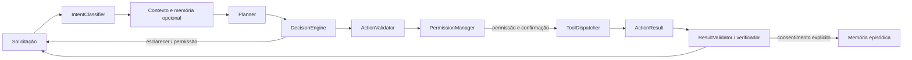

# Preparação operacional da Aurova — etapa 1

Esta etapa prepara exemplos e avaliação; não treina pesos, não faz fine-tuning e não baixa modelos. A amostra é sintética, revisada e independente de memórias. Ollama permanece disponível como provedor já existente.

## Arquitetura encontrada



O código real inclui `CognitiveEngine`, classificação offline (atualmente `organize_downloads` e `unknown`), planejamento, estados canceláveis, timeout por ferramenta, `ActionRegistry`/`ToolDispatcher`, `ActionValidator`, `PermissionManager`, log de ações, memória, identidade/personalidade e perfis. A integração de provedor inclui Ollama e abstrações de provider. O Event Bus é usado pela aplicação desktop; o runtime cognitivo não o usa como protocolo de execução. Plugins são carregados pelo `PluginManager` da aplicação, separados do dispatcher local; o dispatcher rejeita fontes externas.

## Inventário do catálogo

`training/operational/data/catalog.json` é produzido a partir de `create_default_tool_registry()` e registra 13 ferramentas funcionais. Localização-base: `src/aurova_ai/actions/`. Todas têm testes existentes em `tests/aurova_ai/test_actions.py`.

| Ferramentas | Uso | Permissão / confirmação | Risco |
|---|---|---|---|
| `system.clock` | hora local, sem parâmetros | `system.clock.read` | baixo |
| `system.monitor` | métricas agregadas, sem parâmetros | CPU, memória e disco | baixo |
| `files.search`, `files.list_directory` | nomes em diretórios allowlisted | `file.read` e política de diretório | médio |
| `files.preview_downloads` | prévia de organização | `file.read` | baixo |
| `files.organize_downloads`, `files.organize.undo` | movimentos reversíveis / desfazer plano assinado | permissões de organização/movimento e confirmação explícita | alto |
| `apps.list` | lista launchers instalados | `system.app.read` | baixo |
| `apps.launch` | abre ID `.desktop` encontrado | `system.app.launch` e confirmação | alto |
| `reminders.list` | lê lembretes locais | `reminder.read` | médio, dado local |
| `reminders.create`, `reminders.cancel`, `reminders.reactivate` | grava, cancela logicamente ou reativa lembrete | `reminder.write` e confirmação | médio |

Parâmetros/resultados detalhados estão no JSON do catálogo. Validações específicas também residem nas próprias ferramentas, além do validador genérico. Funcionalidade parcial no nível operacional: o planner atual cobre apenas organização de Downloads e pedidos desconhecidos, embora o catálogo possua outras ações. Planejadas/inexistentes no catálogo: leitura/edição de documentos e planilhas, automação geral de teclado/mouse e execução de shell. Portanto “interação com aplicações” limita-se ao catálogo/abertura de launchers. Não há testes de ferramenta de documentos ou automação geral porque tais ferramentas não existem.

## Dados e revisão

- `training/operational/schema.py` valida JSONL `1.0.0`, divisão, tipos básicos e padrões de segredos.
- `data/train.jsonl`: 16 exemplos sintéticos revisados, cobrindo interpretação, planejamento, arquivos, aplicações, documentos/planilhas, recuperação, verificação, segurança e ambiguidades.
- `data/benchmark.jsonl`: 50 tarefas separadas (10 por cada uma das cinco categorias previstas). Nenhum ID ou split de benchmark aparece no treino.
- `data/catalog.json`: catálogo do registro real.
- Origem `synthetic-reviewed-seed`; revisão `reviewed`; nenhum conteúdo vem de memória ou arquivo pessoal.

Para criar exemplos, use apenas solicitações fictícias, siga o esquema, use nomes registrados no catálogo ou lista vazia para capacidade ausente, valide com `validate_record` e faça revisão humana antes de alterar `human_review` para `reviewed`. Não coloque segredos, cookies, tokens, chaves, dados pessoais ou dados copiados de memórias. O detector é uma barreira básica, não uma garantia de anonimização.

## Benchmark

Execute da pasta `desktop_pet_pixel_art/`:

```bash
PYTHONPATH=src:. python3 -m training.operational.cli benchmark
```

O modo `benchmark` usa `ReferenceFakeProvider`, reproduz respostas de referência e valida o harness. O modo `dispatcher` executa 50 tarefas com propostas fixas de fixture, passa 30 chamadas pelo `ActionRegistry`, `ActionValidator`, `PermissionManager` e `ToolDispatcher` reais, e usa ferramentas falsas. Não inicia Ollama nem chama ferramentas reais.

```bash
PYTHONPATH=src:. python3 -m training.operational.cli dispatcher
```

O relatório separa as métricas do dispatcher simulado e do harness. A avaliação do dispatcher usa `ActionRegistry` e `ToolDispatcher` de produção com tools substituídas por fakes; não instancia o registry default porque ele inclui executores reais. Os fakes para documentos/planilhas são explicitamente sintéticos e não tornam essas funções capacidades da Aurova. O subconjunto de planejamento também exercita `CognitiveEngine`: 10 pedidos passaram por interpretação e plano, 5 foram esclarecidos e 5 solicitaram confirmação antes de execução simulada. Nos demais pedidos, a seleção de ferramenta vem da fixture de referência, não de um modelo.

Resultado observado no benchmark desta etapa: 50 tarefas; 30 chamadas despachadas; 25 execuções simuladas bem-sucedidas e verificadas; 25 situações sem ferramenta declaradas; 15 solicitações de confirmação no total (dez abertura de app, cinco organização); e dez cenários de segurança bloqueados. Os sete fakes de capacidade (busca/listagem/organização, catálogo/abertura de apps, leitura de documento e atualização de planilha em memória) passaram. Esses números validam caminhos de integração e segurança; não são score de interpretação ou seleção de um modelo. Inferência real permanece pendente.

## Limite de armazenamento

`StorageManager` mede bytes reais e impõe um teto de no máximo 50 GiB na raiz comum `training/`. Usa lock de arquivo entre processos, reserva a capacidade antes de cada escrita e grava em staging dentro dessa raiz; em exceção, remove apenas o temporário criado pela própria chamada. Tem gravação textual/binária, cópia por blocos, inventário e relatório sem limpeza automática. `training/datasets/processed` e `validation`, `training/experiments`, `training/checkpoints`, `training/operational` e saída de configuração/checkpoint/histórico estão integrados. `TrainingConfig` exige que as raízes de saída estejam sob `storage_root`; o padrão é `training/`.

Distribuição configurável inicial: modelos 10 GB, datasets 8 GB, checkpoints/adaptadores 8 GB, avaliação 4 GB, cache 5 GB, reserva 15 GB. A API de reserva e escrita bloqueia qualquer gravação gerenciada acima de 50 GiB. `training/operational/cli.py storage` mede o consumo total real e lista arquivos com categoria, tamanho, origem conhecida/desconhecida, versão identificável e finalidade. O relatório não apaga nem altera artefatos existentes.

Limitação explícita: não há interceptação global do filesystem. Escritas feitas manualmente ou por outro programa sob `training/` não passam pelo lock, embora sejam contabilizadas no inventário após aparecerem. Entradas brutas em `training/datasets/raw` copiadas por usuário externo também não podem ser barradas antes da criação; importe-as com `StorageManager.copy_file()` para ter preflight. A garantia se aplica às rotas gerenciadas e pressupõe que gravações externas não concorram com elas. Não existe downloader de modelos. Nenhum arquivo é removido automaticamente.

## Preparação futura e limites locais

O pipeline legado oferece preparação textual e um treinador TinyTransformer executado somente por chamada explícita; essa etapa não o executou. Próximos experimentos podem avaliar modelos compactos, quantização e fine-tuning supervisionado, LoRA/QLoRA se o modelo e runtime suportarem, execução local ou GPU externa. Hardware considerado: i3-1005G1, GPU integrada, RAM de upgrade não confirmado e armazenamento limitado. Nenhuma GPU dedicada é pressuposta. Frameworks pesados, downloads e processos residentes ficaram fora desta preparação.

## Auditoria restante

Permission Manager é deny-by-default; o dispatcher reconsulta permissões em cada chamada, valida argumentos e exige `approved=True` em ações com efeito. O validador rejeita chaves de shell/comando e nomes não registrados; acesso de arquivos depende da allowlist. Os testes simulados cobrem ferramenta desconhecida, argumentos inválidos, path fora do sandbox, symlink, permissão negada, confirmação, cancelamento, falha da ferramenta, argumento shell e ação destrutiva não registrada. Execução de app/documento/planilha é estado falso ou arquivos dentro de `TemporaryDirectory`.

`BaseProvider.generate()` e o fluxo de conversa textual permanecem compatíveis. O contrato opcional `ProviderTurn` transporta texto, tool calls, argumentos, IDs, estado, resultados e continuação. `OllamaProvider.generate_turn()` solicita `tool_calls` no endpoint local. O chat encaminha chamadas ao `ToolDispatcher` por `run_operational_loop`; `DesktopAurovaIntegration` continua fornecendo os schemas e o dispatcher. O ciclo cognitivo existente conectado à UI continua cobrindo organização de Downloads; a classificação generativa de outras intenções é conservadora e não substitui o planner amplo.

Memória existente não é exportada para dados; o CognitiveEngine requer consentimento explícito ao registrar experiência. Perfis/persona existentes são preservados. Nenhuma operação real ocorreu nos testes.

## Loop operacional conectado à conversa (Etapa 2)

`DesktopPetAIMixin._ask_worker()` continua sendo a entrada assíncrona da conversa. Após preparar memória, perfil e prompt com `AICore.prepare_request()`, `classify_request()` mantém saudação e conversa comum no `answer_request()` textual. Consultas/tarefas reconhecidas seguem para `run_operational_loop()`, com schemas gerados somente do registry da integração e `ModelRouter.generate_turn()`. Não há fallback que transforma texto afirmativo em execução.

Cada proposta é validada pelo nome registrado, `ActionValidator` e `ToolDispatcher`. O dispatcher reconsulta permissões no momento da execução. Se faltar uma permissão, a UI oferece uma concessão explícita; para ações mutáveis, surge uma confirmação separada, vinculada à chamada `call_id`. A janela não espera a inferência: o worker aguarda sinalização enquanto o loop Tk continua; Aprovar, Negar, Cancelar e fechar a janela são decisões distintas. Depois da confirmação, a autorização e a validação são repetidas no dispatcher. Concessões aceitas permanecem no Permission Manager segundo seu modelo persistente; a aprovação da ação continua sendo por chamada.

Resultados estruturados voltam como mensagens `tool` contendo `tool_call_id` e estado, e o provider pode produzir outra chamada ou uma resposta textual final. O loop é limitado a quatro turnos, seis chamadas e 90 segundos (chamadas individuais continuam sujeitas aos timeouts do router/dispatcher); chamadas repetidas idênticas são bloqueadas. Cancelar durante a confirmação termina o loop. Falha, permissão negada ou ação cancelada não podem ser descritas como sucesso pela resposta final: o worker devolve um estado explícito. A Etapa 2.1 adicionou um botão geral para cancelar cada resposta em andamento; no Ollama o cancelamento da inferência HTTP ativa é cooperativo, conforme detalhado abaixo.

Testes direcionados com provider roteirizado usam o `ToolDispatcher` real e ferramentas falsas. Cobrem classificação conversacional/consulta/tarefa, consulta ponta a ponta com continuação do provider, duas chamadas sequenciais com contexto, aprovação/negação/cancelamento, falta de permissão, proteção contra repetição, ferramenta desconhecida, limite de turnos e bloqueio de chamadas após negativa. Eles comprovam a integração de serviço, não uma sessão visual automatizada da janela Tk nem inferência real Ollama.

O benchmark continua sem certificar qualidade de linguagem ou chamadas de ferramenta de um modelo: suas propostas são fixtures fixas, sem inferência. A modalidade `dispatcher` exercita `PermissionManager`, `ToolDispatcher` e cenários de segurança com ferramentas falsas e filesystem temporário. Permanecem indisponíveis visão computacional, automação geral de mouse/teclado e ferramentas de edição de documentos/planilhas. Não afirmar operação geral do computador.

## Validação e estabilização (Etapa 2.1)

### Tk e cancelamento

Os testes de integração Tk em Xvfb criam diálogos reais e usam somente a ferramenta fictícia. Cobrem Aprovar, Negar e Cancelar como decisões distintas, polling do thread principal durante a espera, cancelamento do diálogo de progresso e liberação do worker quando o pedido é cancelado ou a aplicação encerra a confirmação. O callback seguro converte erro ao abrir a confirmação em decisão `cancel`. O encerramento chama o finalizador da confirmação ativa; os timers Tk são removidos ao fechar o diálogo. Isto valida os widgets e o ciclo de callbacks automatizado, não uma inspeção visual/manual da janela completa.

Cada pedido possui seu próprio `threading.Event`, propagado da UI ao worker, loop, router e provider. O loop verifica o sinal antes e depois do provider, antes do dispatcher, durante a confirmação e após a ferramenta; cancelamento impede chamadas seguintes. Chamadas simultâneas são recusadas pelo lock de inferência do worker, sem compartilhar a autorização vinculada à chamada. Ollama usa `urllib` sem streaming/cancelamento de socket: uma geração HTTP já iniciada não é interrompida no servidor. O botão sinaliza cancelamento, mantém a UI responsiva e o resultado é descartado quando a requisição retorna ou atinge o timeout do provider (até 30 s); o loop não executa ferramenta depois disso. O timeout total do loop é 90 s. Portanto o cancelamento é cooperativo, não interrupção imediata da inferência.

### Classificação e planner

O classificador operacional distingue conversa, consulta, tarefa, ambiguidade e pedido não suportado. Variações em português para consulta da hora caem na mesma categoria; saudações e pedidos de curiosidade ficam no fluxo textual; pedidos genéricos sobre organização são tarefas que pedem esclarecimento quando faltam dados. Para organização de Downloads, reaproveita o classificador cognitivo e o planner existentes, incluindo variações como “deixar organizada”. O planner continua específico para Downloads; não há planejador universal. A ferramenta só pode vir do registry real.

### Integração com Ollama local

Foi encontrado `llama3.2:1b` já instalado (tamanho mostrado por `ollama list`: aproximadamente 1,3 GB). Não houve pull nem alteração do modelo. O teste opt-in `tests/aurova_ai/test_ollama_live.py` usa inferência local, `test.echo` fictícia e o `ToolDispatcher` real; não oferece operações de arquivos/sistema ao modelo. Mensagem textual foi recebida. Em tentativas com o loop operacional, o modelo também devolveu JSON em texto comum, corretamente rejeitado como chamada estruturada. Na sequência controlada de integração direta, a resposta estruturada foi parseada, nome/argumentos validados e a ferramenta falsa foi executada exatamente uma vez; a continuação real recebeu o resultado `07:45`, porém respondeu `ok`, repetindo o argumento de entrada. Assim, tool calling foi demonstrado nesta solicitação artificial, mas a resposta final não foi fundamentada corretamente e o objetivo ponta a ponta permanece **parcial**.

Os tempos observados foram aproximadamente 4,7–5,7 s para texto, 8,0 s para proposta e 6,4 s para continuação, variando entre execuções. `ollama ps` não mostrou modelo residente após o teste; uso de memória não ficou disponível. O teste live é opt-in e a asserção sobre `07:45` permanece falhando de propósito para expor a limitação. Não usar esse resultado como validação operacional geral.

### Validação executada e limites

Executados: 85 testes direcionados de loop operacional, preparação operacional, worker, cognição e providers (passaram); 4 testes Tk sob Xvfb (passaram, incluindo subcasos dos três botões); `py_compile` nos módulos/testes alterados; `git diff --check`. O teste live opt-in foi executado contra o Ollama disponível e falhou somente na verificação de que a resposta final contém `07:45`; chamada estruturada e despacho da ferramenta falsa passaram. Nenhum teste executou ações reais no computador. A execução do live test é integração real com Ollama, enquanto os testes unitários usam providers roteirizados/falsos.

Status operacional: UI e propagação de cancelamento cooperativo implementadas e testadas sob Xvfb; corte de uma requisição HTTP em voo não é suportado pelo transporte; continuação do modelo real não passou grounding; classificação melhorada e coberta; planner permanece limitado à organização de Downloads. A Etapa 2.1 não deve ser marcada como integralmente concluída enquanto a continuação real do modelo não usar corretamente o resultado da ferramenta.

## Correção do ciclo Ollama (Etapa 2.2)

### Investigação e causa do resultado anterior

O endpoint usado é `/api/chat`. A requisição recebe `model`, `messages`, `tools`, `stream: false` e opções locais limitadas. Respostas são convertidas de `message.tool_calls` para `ProviderTurn`; texto comum continua texto e não é promovido a chamada. O loop conserva a mensagem do usuário, acrescenta a mensagem `assistant` com as chamadas propostas, e acrescenta um `role: tool` por resultado antes da inferência seguinte. O prompt de sistema é novamente enviado no topo de cada requisição e o histórico não é reconstruído só a partir do último turno.

A forma do histórico correspondia ao protocolo documentado do Ollama: mensagem `assistant` com `tool_calls`, seguida por `role: tool`, `tool_name` e `content`. O formato interno não era idêntico: incluía IDs usados internamente e serializava sucesso como um JSON envelope com `state`, `summary` e `data`. A documentação oficial exemplifica o resultado como conteúdo da mensagem `tool` e `tool_name`; o tipo atual também aceita `tool_call_id` ([API de chat](https://github.com/ollama/ollama/blob/main/docs/api.md), [tool calling](https://github.com/ollama/ollama/blob/main/docs/capabilities/tool-calling.mdx)).

O teste que obteve `ok` também instruía o modelo a chamar a ferramenta com o argumento literal `value="ok"`. Portanto, o teste deixou esse texto muito saliente e não isolava se o resultado havia sido entregue incorretamente. A mensagem de ferramenta estava presente no histórico; não há evidência de que a falha anterior fosse uma ausência de retorno no protocolo. O envelope aninhado adicionava ruído e foi simplificado para enviar diretamente dados de sucesso (objeto JSON compacto ou texto retornado), mantendo `tool_name` e `tool_call_id`. Resultados sem dados recebem marcador explícito; falhas mantêm estado e motivo, nunca são serializadas como sucesso.

### Mudanças e testes

`ProviderTurn.to_ollama_messages()` torna explícito o mapeamento do contrato interno ao protocolo Ollama. Cada chamada `assistant` preserva nome, argumentos e ID; cada resultado correspondente preserva nome/ID e usa o campo `content`. O loop chama esse mapeamento, e a instrução operacional reforça que o modelo deve usar os valores da mensagem `tool`, sem copiar argumentos ou inventar conteúdo. O dispatcher, validação, PermissionManager, limites e bloqueio de repetição permanecem as autoridades de execução.

Testes com providers falsos e dispatcher real cobrem histórico completo e prompt de sistema, correspondência chamada/resultado, dois resultados distintos, valor JSON `07:45`/`13:20`, resultado textual, falha, conteúdo vazio, caracteres especiais e texto que apenas menciona JSON. Também verificam que retorno textual não vira tool call. São testes A/B; não são evidência de qualidade do modelo.

Ollama local encontrado: `llama3.2:1b`, aproximadamente 1,3 GB (`ollama` 0.34.4). Não foi baixado ou alterado. Com `test.clock` fictícia e dispatcher real, a proposta estruturada foi parseada, validada e despachada uma vez. A resposta da ferramenta foi enviada como `role: tool`, `tool_name: test.clock`, ID correspondente e `content: {"time":"07:45"}`; o modelo respondeu `Foram 07:45 horas.`. Tempos observados: texto 4,76 s; proposta 6,22 s; continuação 5,50 s. O teste de grounding real passou sem pôr o valor de retorno no pedido original.

O tratamento real de falha foi testado com uma chamada estruturada fictícia fornecida pelo teste, dispatcher real e continuação Ollama. A resposta declarou indisponibilidade sem afirmar sucesso (6,81 s). Isso testa a interpretação da falha na continuação; a seleção da ferramenta nesse cenário foi isolada, não gerada pelo modelo. Resultados vazios e especiais estão cobertos por teste de contrato/provider falso, não por inferências reais.

Em uma sequência local controlada, o modelo selecionou `test.facts` e depois `test.clock`; ambos foram executados uma vez, e suas mensagens de resultado permaneceram separadas. Sem schemas de ferramenta na inferência final, o modelo resumiu `operacional` e `07:45`. Isso não representa o loop de produção, que mantém o catálogo disponível para permitir novas chamadas. Com os dois schemas disponíveis na inferência final, o teste controlado excedeu o timeout configurado de 25 s (o router permite no máximo 30 s); em outra tentativa, a resposta se concentrou nos nomes/schema em vez dos resultados. Na última execução instrumentada, o modelo produziu uma chamada estruturada com argumentos inválidos já no primeiro turno (16,60 s; `messages=1`, `tools=1`, `proposed=1`, `dispatcher_calls=0`), então o dispatcher não foi invocado. Logo, o caminho real de duas chamadas sequenciais até resposta final ainda não foi validado com `llama3.2:1b` nas condições do loop de produção, e a seleção de argumentos não foi consistente entre execuções.

`ollama ps` após os testes não listou processo/modelo residente, portanto a memória de execução não foi observada. O tamanho local foi 1,3 GB. Não houve operação real no computador; as únicas ferramentas eram fakes.

### Validação e estado

Passaram 89 testes direcionados A/B de provider, dispatcher, loop, worker, cognição e preparação operacional; `py_compile` e `git diff --check`. O teste Tk da etapa anterior não foi alterado. Integração C real: texto, chamada estruturada, despacho e grounding de uma ferramenta passaram; continuação de falha passou com proposta artificial; sequência real de duas ferramentas foi despachada, mas sua resposta final expirou com catálogo disponível. As outras tentativas malformadas continuam tratadas como texto/erro, sem conversão em chamada.

Conclusão Etapa 2.2: **PARCIALMENTE IMPLEMENTADA**. O protocolo e grounding de uma ferramenta foram corrigidos e demonstrados no Ollama local. O grounding de várias chamadas no loop de produção segue limitado pelo modelo/tempo observado; não afirmar que o ciclo operacional completo está validado. Não iniciar treinamento ou troca de modelo nesta etapa.

## Estabilização multi-tool (Etapa 2.3)

### Diagnóstico por turno

`run_operational_loop()` agora emite logs de diagnóstico sem conteúdo do usuário, prompt, argumentos ou resultados: número do turno, mensagens enviadas (incluindo system) e histórico, quantidade de schemas, propostas, chamadas ao dispatcher, estados de resultado, tempo de inferência, estado de cancelamento, tipo da resposta e motivo de continuação/encerramento. Esses campos permitem distinguir timeout/erro do provider, texto final vazio, chamada estruturada e finalização normal. Os testes verificam que o diagnóstico não registra mensagem nem argumento sensível. O teste live `test_ollama_live.py` também imprime por turno somente papéis das mensagens e contagens, inclusive quando o provider expira.

### Experimentos controlados

| Experimento | Entrada e estado observado | Resultado |
|---|---|---|
| 1 — uma ferramenta | Catálogo de teste com `test.clock`; histórico user → assistant tool call → tool result; resultado fictício `07:45`; final com catálogo disponível. | Em execução anterior, grounding passou em 16,48 s total (texto 4,76 s, proposta 6,22 s, final 5,50 s). Na rechecagem instrumentada desta etapa, turno 1 recebeu 1 mensagem de histórico e 1 schema, levou 16,60 s, retornou uma chamada estruturada, mas os argumentos eram `{"type":"object","properties":{}}` em vez de `{}`. Nenhuma chamada foi enviada ao dispatcher nessa tentativa. Portanto a capacidade não foi estável/reproduzida. |
| 2 — duas ferramentas | `test.facts` e `test.clock`, uma ferramenta pertinente exposta por turno, resultados distintos. Mensagens preservaram ordem e associação. | As duas propostas e despachos ocorreram. Com catálogo ainda anunciado no turno final, a inferência final excedeu o timeout configurado de 25 s (limite do router: máximo 30 s). Sem ferramentas no turno final, o modelo respondeu com `operacional` e `07:45`; esse resultado não representa a configuração de produção. |
| 3 — catálogo reduzido | Somente a ferramenta da etapa corrente foi anunciada durante cada chamada. | Propostas de status e horário foram selecionadas separadamente. Catálogo retirado no final (nenhuma ferramenta necessária depois das duas etapas) permitiu resposta fundamentada; não há plano geral que autorize essa retirada automaticamente para toda solicitação. |
| 4 — fase de finalização | Mesmo histórico multi-tool, instrução para responder e nenhum schema no pedido final. | Finalização passou no teste controlado. Não foi adicionada uma fase automática que desative ferramentas: o loop atual não tem um plano verificável que determine, para pedidos gerais, quando a tarefa está completa. O endpoint nativo não oferece um campo `tool_choice=none` para desligá-las mantendo o catálogo; retirar `tools` é a alternativa protocolar, mas a política precisa primeiro saber que nenhuma ferramenta adicional é necessária. |
| 5 — grounding de dois resultados | Histórico integral com estado `operacional` e horário `07:45`. | Ambos apareceram corretamente na resposta sem catálogo. Com catálogo presente, houve timeout; grounding multi-tool em produção permanece não demonstrado. |
| 6 — limites | Rechecagem multi-tool: `ai_timeout=25 s`, `num_ctx=768`, `num_predict=72`, 1 thread; loop continua limitado a 4 turnos, 6 chamadas e 90 s, router até 30 s. | Nenhum limite foi aumentado. A inferência de resposta final foi a etapa que expirou quando o catálogo permaneceu disponível. `ollama ps` não mostrou processo após os ensaios; não foi possível medir RAM. |

O retorno de falha foi enviado numa continuação real (proposta estruturada construída pelo teste para isolar essa fase); Ollama informou indisponibilidade em 6,81 s. Testes A/B cobrem duas ferramentas com resposta scripted contendo os dois valores; falha de uma ou ambas, resultado vazio, caracteres especiais, repetição e limites. Esses casos não substituem os ensaios Ollama. A execução real de duas ferramentas foi confirmada, mas a conclusão com catálogo disponível falhou; a rechecagem de uma ferramenta também mostrou argumentos inválidos. Nenhuma falha é convertida em sucesso pelo loop.

Testes direcionados após a instrumentação: 91 testes de loop, contrato/provider, dispatcher/preparação, worker, cognição e providers passaram; `py_compile` e `git diff --check` passaram. Testes reais opt-in são avaliações separadas: grounding de uma chamada e continuação de falha tiveram execuções aprovadas; sequência final com catálogo gerou timeout; a rechecagem instrumentada de chamada única gerou argumentos inválidos e foi bloqueada antes do dispatcher.

Conclusão Etapa 2.3: **PARCIALMENTE IMPLEMENTADA**. O histórico e associação de resultados estão corretos e instrumentados, e a finalização sem ferramentas passa quando explicitamente apropriada. O caminho local real com catálogo disponível ainda não produz resposta multi-tool consistente dentro do timeout. A causa do timeout foi localizada na inferência final com ferramentas disponíveis; os ensaios não distinguem definitivamente uma limitação do modelo de uma demora de decodificação/seleção. Não aumentar timeout nem remover ferramentas por atalho. Preservar o diagnóstico como limitação aberta.

## Controle de continuidade e finalização (Etapa 2.4)

### Arquitetura

`operational_loop.py` agora constrói um `OperationalPlan` validado a partir de nomes de ferramentas mencionados no pedido ou de correspondências semânticas restritas para consultas conhecidas. O plano contém objetivo, etapas, ferramenta e critério de evidência; não cria nomes fora dos schemas recebidos. Quando existe plano guiado, cada inferência de execução recebe somente o schema da próxima etapa. Depois de cada despacho, a política gera uma `ContinuityDecision` tipada e validada: `continue`, `finalize`, `clarify` ou `blocked`. A decisão de finalização exige etapas guiadas concluídas, resultado bem-sucedido e dado não vazio. Falha, vazio, chamada repetida, proposta fora da etapa, timeout ou cancelamento não podem ser convertidos em sucesso.

Só a decisão `finalize` passa à fase final, com zero schemas; o prompt pede resposta apoiada nos resultados já recebidos. Se o provider responde em texto enquanto há etapa pendente, o loop mantém `continue` e tenta a chamada requerida novamente. Duas respostas sem progresso levam a `blocked`, sem inventar conclusão. Pedidos fora das correspondências restritas mantêm seleção dinâmica pelas ferramentas disponíveis e não ganham plano pré-fabricado.

Execução continua passando exclusivamente por `ToolDispatcher`, que revalida schema/argumentos, permissões e confirmação sensível. Propostas fora dos schemas da etapa são bloqueadas antes do dispatcher. Mensagens assistant que combinam tool calls com texto incoerente têm esse texto removido do histórico enviado ao Ollama. Permanecem os limites gerais de 4 turnos, 6 chamadas e 90 s; o timeout do roteador não foi ampliado. Logs registram contagens, fase, decisão, estado e duração, sem prompts, argumentos ou conteúdo de resultados. Não foram executadas operações reais no computador.

### Experimentos desta etapa

| Cenário | Resultado observado |
|---|---|
| Uma ferramenta disponível | `test.facts` foi chamada e despachada uma vez no ensaio integrado intermediário; a execução não chegou à etapa seguinte. A tentativa mais recente com o fluxo reforçado recebeu 1 schema, levou 20,16 s e retornou texto com JSON do schema, não `tool_calls`. |
| Duas ferramentas pertinentes | Planejamento de `test.facts` e `test.clock` filtrou cada etapa para 1 schema. Em execuções após `test.facts`, o modelo respondeu em texto (incluindo referência a Python/Jupyter) em vez de chamar `test.clock`; o ciclo foi bloqueado sem declarar conclusão. Critério de resposta com os dois valores **não atendido**. |
| Catálogo reduzido | A arquitetura envia apenas o schema da etapa atual (1 em vez dos 2 schemas do fixture) e zero no turno de finalização. A sequência real não completou; portanto o ganho de latência/qualidade não é comprovado. |
| Catálogo completo | Não foi executado um benchmark real com as 13 ferramentas de produção nesta etapa. As contagens do catálogo completo continuam sem medição comparável. |
| Continuação após um resultado | No teste real integrado, após `test.facts`, o modelo não selecionou `test.clock` com consistência. Nas amostras, as inferências subsequentes ficaram entre 2,01 s e 9,03 s; em outra tentativa, a primeira resposta em texto levou 20,16 s. |
| Continuação após dois resultados | Não alcançada no teste integrado atual, pois a segunda tool call não ocorreu. Os testes com provider falso validam associação distinta, mas não provam comportamento real do modelo. |
| Finalização sem schemas | A arquitetura só envia zero schemas depois de todas as etapas guiadas terem evidência; esse estado não foi atingido no cenário real de duas ferramentas. A finalização é coberta determinística pelos testes com provider falso. |
| Argumento inválido/texto que parece JSON | Propostas inválidas continuam rejeitadas pelo parser/validator e o dispatcher não é chamado. No teste real mais recente, o modelo produziu JSON textual do schema; não foi convertido em tool call. |
| Falha de ferramenta | Com falha de fixture despachada pelo dispatcher, a continuação Ollama respondeu que não obteve/verificou o resultado; teste passou (inferência final de 4,28 s numa das repetições). A proposta inicial foi construída pelo teste para isolar interpretação da falha. |
| Resultado vazio | O modelo selecionou `test.facts`; a ferramenta retornou vazio e foi despachada uma vez. O loop bloqueou a finalização sem pedir uma resposta generativa adicional (10,04 s total). Teste real passou. |

O runtime local foi confirmado com `ollama list`: `llama3.2:1b`, 1,3 GB, sem download. As tentativas integradas não expiraram o limite de 25 s por inferência, mas a primeira chamada de uma tentativa levou 20,16 s. A falha determinante nesta etapa foi a inconsistência de tool calling: o provider recebeu schemas e devolveu texto/JSON textual ou resposta irrelevante, com zero propostas estruturadas em tentativas; o dispatcher não interpretou essas respostas como chamadas. Isso separa a falha atual da lentidão final observada na Etapa 2.3. `ollama ps` após os testes não listou modelo residente; RAM/CPU durante inferência não foram medidas.

### Validação e estado

Testes direcionados de loop, contrato/provider, desktop worker e integração: 67 passaram e 5 testes live opt-in foram ignorados (`72` total). `py_compile` para os arquivos Python alterados e `git diff --check` passaram. O teste live de falha e o de resultado vazio passaram em execuções separadas. O teste live obrigatório de duas ferramentas foi executado e falhou no critério: as duas chamadas não foram despachadas, portanto não há resposta real fundamentada simultaneamente em `operacional` e `07:45`. A proteção bloqueou a resposta após ausência repetida de progresso.

Conclusão Etapa 2.4: **PARCIALMENTE IMPLEMENTADA**. Planejamento limitado, controle por etapa, decisão explícita, bloqueio de falhas/vazios e finalização sem schemas após evidências estão integrados e cobertos deterministicamente. O critério real obrigatório de duas ferramentas e resposta final fundamentada falhou com o Ollama `llama3.2:1b`; não declarar o ciclo multi-tool real concluído.

## Avaliação de modelos para execução de ferramentas

### Ambiente e protocolo da medição

Branch `Nova-IA`. `ollama list` mostrou somente `llama3.2:1b` (1,3 GB); `ollama show` mostrou 1,2B parâmetros, quantização `Q8_0` e capability `tools`. Nenhum outro modelo local estava disponível para comparação. O ambiente reportou Intel Core i3-1005G1, sem GPU dedicada (GPU Intel integrada), RAM utilizável total de 3,6 GiB, 1,1 GiB disponíveis e swap de 4,1 GiB (1,1 GiB disponível) no instante da consulta; disco com 102 GiB livres. A RAM não foi medida durante inferência e o upgrade planejado não foi considerado realizado. `ollama ps` após os testes não mostrou processo residente.

Todas as chamadas desta avaliação usaram o mesmo modelo e configuração: `ai_timeout=25 s`, `num_ctx=512`, `num_predict=48`, `num_thread=1`, chamadas não streaming pelo `ModelRouter`/`OllamaProvider`, sem loop cognitivo. Os schemas foram `additionalProperties:false`, e o harness conferiu nomes e argumentos diretamente. JSON em texto permaneceu texto; nunca foi convertido em chamada. Ferramentas e resultados de grounding eram fixtures. Não houve dispatcher de ferramentas reais, treinamento, pull/download ou aumento de timeout. O harness opt-in com registros de cada inferência está em `tests/aurova_ai/test_model_capability_live.py`.

### Matriz isolada — uma amostra por inferência

Os casos centrais de formato e seleção tiveram cinco repetições; descrição curta e detalhada tiveram uma amostra comparativa cada.

| Caso | Latências individuais (s) | Resultado |
|---|---|---|
| Schema sem argumentos — 5 | 11,45; 1,97; 1,92; 1,92; 1,92 | 5/5 `tool_calls`, nome e `{}` válidos. Primeira chamada fria foi mais lenta. |
| Um argumento string obrigatório — 5 | 3,46; 2,02; 2,02; 2,03; 2,08 | 5/5 chamadas e `{"query":"status"}` válidos. |
| Dois argumentos obrigatórios — 5 | 5,31; 4,20; 3,23; 2,65; 2,53 | 5 tool calls com nome correto, só 2/5 argumentos válidos. Duas vezes `value` veio string (`"3"`); uma vez o modelo copiou propriedades do schema para os argumentos. |
| Descrição curta — 1 | 2,84 | Tool call e argumentos corretos. |
| Descrição detalhada — 1 | 3,80 | Tool call e argumentos corretos. Não há amostras suficientes para concluir efeito da descrição. |
| Duas ferramentas disponíveis, pedido só por `test.facts` — 5 | 4,41; 1,94; 1,78; 1,96; 2,26 | 4/5 tool calls corretas; numa repetição respondeu com JSON textual `{"name":"test.facts",...}` e não fez chamada. Nenhuma ferramenta inventada como tool call. |

Resumo da matriz: 22 inferências, 21 respostas com `tool_calls`, 18 chamadas com argumentos exatamente válidos, 3 inválidas, 1 resposta em JSON textual, 0 nomes de ferramentas inventados e 0 timeouts/erros do provider. Isto mede chamadas solicitadas; não significa que 18 ações tenham sido despachadas.

### Grounding e sequência multi-tool

| Cenário | Repetições e latências observadas (s) | Chamadas/argumentos | Grounding e conclusão |
|---|---|---|---|
| A — uma ferramenta, retorno `{"status":"operacional"}`, schema continua disponível na resposta — 5 | proposta: 3,03; 5,34; 5,92; 5,08; 5,00. Resposta: 3,64; 3,77; 2,32; 2,55; 3,56. | A proposta inicial foi válida 5/5. Na resposta final ocorreu uma tool call repetida com argumento extra; as outras respostas foram JSON textual ou texto. | 0/5 respostas finais mencionaram `operacional` como resultado retornado. |
| B — duas chamadas em sequência, próximo schema reduzido e schemas presentes na inferência final — 6 execuções (uma isolada e um bloco de cinco) | No bloco de cinco: etapa 1 9,66; 5,82; 3,54; 5,77; 3,69. Etapa 2 quando alcançada: 10,15; 3,24; 8,45; 5,20. Uma execução adicional: 13,43; 6,33; final 4,63. | A primeira chamada teve argumentos válidos em 5/6 execuções. A segunda etapa válida ocorreu em 2/5 tentativas em que foi proposta. Em respostas finais foram propostas chamadas extras a `test.facts`, com dados indevidos nos argumentos. | 0/6 tarefas concluídas. Houve uma resposta final que continuou pedindo ferramenta em vez de encerrar. |
| C — decisão com ambas as ferramentas anunciadas após receber o resultado de `test.facts` — 5 | decisão: 13,52; 7,06; 2,69; 2,72; 1,70. Final, quando houve tool call válida: 4,32; 4,43. | O primeiro resultado `test.facts` foi semeado pelo fixture para isolar a decisão, não gerado pelo modelo. Seleção estruturada de `test.clock` com `{}` em 2/5; 2/5 argumentos inválidos e 1/5 JSON textual. | 1/5 amostras incluiu `operacional` e `07:45` na resposta final. C não é evidência de fluxo ponta a ponta, pois o resultado facts foi inserido pelo harness. |
| D — duas etapas sequenciais e finalização com zero schemas — 5 | etapa 1: 1,87; 3,31; 4,18; 5,97; 3,26. Etapa 2: 3,28; 1,67; 4,87; 1,83. Final: 7,17; 5,80; 1,99. | Os dois tool calls em sequência tiveram argumentos válidos em 3/5 tarefas; foram 2 argumentos inválidos. Só 3/5 chegaram à inferência final. As três finais foram JSON textual (não tool calls). | 1/5 respostas finais incluiu ambos os valores; 0/5 foi uma resposta natural consistente. A amostra correta não valida confiabilidade. |

Não houve timeout de inferência nos ensaios. O maior tempo individual da matriz isolada foi 11,45 s; nos cenários em sequência houve inferências de 13,52 s. A latência variou conforme contexto e chamada; velocidade isolada não foi usada como critério de superioridade.

### Contagens e classificação das falhas

Na matriz isolada: 21 tool calls; 18 argumentos válidos e 3 inválidos. No conjunto de grounding medido (A, B, C e D): 54 tool calls observadas nos diferentes blocos, 39 com argumentos válidos e 15 inválidos ou chamadas extras incompatíveis com a etapa. O número de conclusão de duas ferramentas foi 0/6 em B e 1/5 em D; C obteve 1/5, mas com o primeiro resultado semeado. Esses denominadores são cenários diferentes e não devem ser somados como taxa única de produção.

- **Geração do modelo:** respostas sem tool call quando requerida, JSON textual no lugar de chamada, tool call repetida e chamada extra após os resultados.
- **Validação:** três argumentos inválidos na matriz de schemas e 15 no bloco de grounding; exemplos incluem string no lugar de número, cópia de schema no objeto de argumentos e argumento de resultado em chamada final inesperada.
- **Grounding/finalização:** falha dominante. A resposta após uma ferramenta foi 0/5; as saídas finais multi-tool foram variáveis e frequentemente JSON textual, incompletas ou com nova chamada.
- **Contrato/adaptador Ollama:** nenhuma evidência de defeito nesta medição. `message.tool_calls` estruturados foram parseados como `ProviderTurn`; conteúdo JSON comum permaneceu em `ProviderTurn.text`. As respostas inválidas de argumentos chegaram estruturadas e foram contadas como inválidas pelo harness.
- **Dispatcher:** não avaliado como causa nestes ensaios diretos; nenhum executor real foi chamado. As fixtures de resultado foram inseridas somente após a proposta esperada passar no teste.
- **Timeout:** 0 nesta matriz; não se aumentou o limite para obter resultado positivo.

### Recomendação

`llama3.2:1b` tem capacidade real de emitir tool calls nativas simples e escolher a ferramenta correta em amostras repetidas. Não demonstrou aderência consistente para dois argumentos e grounding/finalização multi-tool: em D concluiu 1/5 tarefas, e no cenário de uma ferramenta não usou corretamente o único resultado em 5/5 respostas finais. Portanto **não é candidato operacional aprovado para tarefas multi-tool** nesta máquina, apesar da capability `tools` anunciada pelo Ollama.

Não havia outro modelo instalado, então não há vencedor nem comparação entre modelos. Para a Etapa 2.6, recomendo primeiro definir um benchmark de aceitação repetível e avaliar um modelo local já disponível ou um futuro candidato apenas após autorização explícita de download e confirmação de memória. O candidato deve produzir chamadas nativas (não JSON em texto), respeitar tipos e campos obrigatórios, selecionar uma ferramenta por etapa quando pedido, manter associação de resultados, usar evidência sem inventar, reconhecer quando continuar e finalizar sem schemas; deve passar pelo menos cinco repetições de sequência e grounding, tratar falhas/vazios com segurança e caber nos limites de CPU/RAM medidos. Não iniciar treinamento nem mudar o modelo atual nesta recomendação.

## Seleção do modelo operacional — Etapa 2.6

### Auditoria do ambiente

Auditoria feita em 2026-11-17, branch `Nova-IA`:

| Recurso | Medição | Observação |
|---|---|---|
| CPU | Intel Core i3-1005G1, 2 núcleos / 4 threads, até 3,40 GHz | `lscpu`; CPU x86_64 com AVX2. |
| GPU | Intel integrada, dispositivo DRM `card1` | `nvidia-smi` não existe; GPU dedicada/VRAM não foi identificada. Considere memória compartilhada. |
| RAM | 3,6 GiB visíveis; 887 MiB disponíveis na medição; swap 4,1 GiB (1,1 GiB livre) | `free -h`. Medida pontual, varia com os processos ativos. Upgrade para 12 GB não confirmado. |
| Disco | 102 GiB livres na partição do projeto (234 GiB total) | `df -h .`. |
| Ollama | CLI 0.34.4; daemon local respondeu | `ollama list` mostrou somente `llama3.2:1b`, 1,3 GB. |
| Dados de treinamento/experimentos | `training/` total: 364 KiB (`operational`: 236 KiB; `operational-material`: 8 KiB) | O limite definido é 50 GiB. Uso atual está muito abaixo do limite; não há quota de filesystem configurada. |

### Candidatos pesquisados

Os tamanhos abaixo são os publicados no catálogo Ollama para as variantes quantizadas indicadas; são tamanhos do artefato, não estimativas da RAM total. Inferência também usa memória do runtime, contexto/KV cache e sistema operacional. O contexto de 256K publicado para algumas variantes não é recomendado neste computador; começar com os 512 tokens do harness e medir o pico real de RAM.

| Candidato (variante) | Parâmetros / quantização / download | Suporte documentado | Adequação ao hardware e limitações |
|---|---|---|---|
| `qwen2.5:1.5b` | 1,5B; Q4_K_M; ~986 MB | Ollama lista a família Qwen2.5 como compatível com tools. | **Compatível condicionalmente com o hardware atual** para avaliação curta em CPU. O tamanho menor não prova capacidade superior nem grounding; sem resultados do harness. |
| `qwen3:1.7b` | 1,7B; Q4_K_M; ~1,4 GB | Ollama documenta Qwen3 na categoria de modelos com tools. | **Compatível condicionalmente com risco de swap**: o arquivo excede a RAM livre observada. Inferência pode ser lenta. Nenhum resultado do harness. |
| `qwen3.5:2b` | 2B; Q4_K_M por padrão do catálogo; 2,7–3,1 GB | Catálogo Ollama marca Qwen3.5 com tools. | **Inadequado para 4 GB**: o arquivo ocupa quase toda RAM física; contexto/runtime deixam margem insuficiente. Em 12 GB poderia ser avaliado, mas há candidato maior. |
| `qwen3.5:4b` | 4,21B; Q4_K_M; 3,3 GB (catálogo apresenta manifestos até 4,0 GB) | Suporte a tools listado pela Ollama. A página da variante publica score 43,8 no Tool Decathlon. | **Recomendado somente após upgrade para 12 GB**. Candidato prioritário ao benchmark local. O score é uma alegação/resultado publicado pelo fornecedor, não teste da Aurova nem comprovação de grounding. CPU pode deixar a inferência lenta. |
| `gemma4:e2b` | 2,3B efetivos (5,1B incluindo embeddings); publicado entre 4,6–7,5 GB | Família Gemma 4 aparece no catálogo Ollama com tools; o cartão lista texto/imagem/áudio. | **Somente após upgrade para 12 GB**, como comparador. A variação grande do tamanho e dos parâmetros efetivos/totais dificulta prever memória. Ainda precisa validar parser e harness. |
| `gemma3:4b` | 4B; ~3,4 GB | A página consultada lista visão, mas não marca tools para a família na página principal. | **Inadequado como candidato de tool calling nesta etapa** por falta de evidência documental explícita de suporte nativo a tools para esta variante; margem de RAM também é pequena. JSON textual não substitui tool call. |
| `qwen3:8b` | 8B; 5,2 GB | Tool calling documentado pela Ollama. | **Inadequado** para 4 GB e não recomendado para 12 GB: o arquivo já consome 5,2 GB antes de runtime, contexto e sistema. |

Fontes técnicas primárias: catálogo oficial Ollama para [Qwen2.5](https://ollama.com/library/qwen2.5), [Qwen3](https://ollama.com/library/qwen3), [Qwen3.5](https://ollama.com/library/qwen3.5), [Qwen3.5 4B](https://ollama.com/library/qwen3.5:4b), [Gemma 4](https://ollama.com/library/gemma4) e [Gemma 3](https://ollama.com/library/gemma3); documentação Ollama sobre [tool support](https://ollama.com/blog/tool-support) e [streaming/tool calling](https://ollama.com/blog/streaming-tool). A marcação `tools` comprova suporte documentado na integração Ollama, não que a variante passe schemas, tipos, sequência ou grounding próprios da Aurova.

### Matriz de decisão e recomendação

| Hardware | Classificação | Decisão |
|---|---|---|
| Atual: 4 GB nominais, 3,6 GiB visíveis e 887 MiB disponíveis no instante medido | Avaliação exploratória curta: `qwen2.5:1.5b`; `qwen3:1.7b` com risco de swap | Nenhum candidato novo recomendado como núcleo operacional. Manter `llama3.2:1b` como baseline, sem substituição. |
| Upgrade confirmado para 12 GB | **Recomendado:** `qwen3.5:4b` Q4_K_M. **Comparador:** `gemma4:e2b`. | Avaliar primeiro Qwen3.5 4B, condicionado a autorização para download e à medição de RAM real. Gemma é comparação, não seleção aprovada. |
| Artefatos acima de ~5 GB, incluindo `qwen3:8b` | Inadequado para esta máquina como configuração padrão | Margem insuficiente para inferência interativa confortável; RAM nominal não prova compatibilidade. |

**Melhor candidato para 4 GB:** nenhum candidato foi selecionado para operação. `qwen2.5:1.5b` é a opção mais prudente para um experimento curto, por tamanho de arquivo menor que o baseline instalado, mas isso não comprova melhoria de capacidade nem execução estável com a memória livre medida. `qwen3:1.7b` tem suporte documentado e maior porte, com maior risco de swap. **Melhor candidato após confirmação de 12 GB:** `qwen3.5:4b` Q4_K_M; usar `gemma4:e2b` como comparador secundário.

Não foi executado benchmark local nem baixado modelo. O Tool Decathlon publicado na página do Qwen3.5 4B é evidência externa do fornecedor, não substitui cinco repetições dos cenários Aurova. As estimativas de RAM são qualitativas: tamanho do download é conhecido, mas o pico de RSS destes candidatos neste host ainda não foi medido. Swap não equivale a RAM adequada para uso interativo.

### Protocolo, integração e pendências

O harness `tests/aurova_ai/test_model_capability_live.py` deve continuar com os mesmos prompts, schemas, configurações e critérios já definidos: `ai_timeout=25`, `num_ctx=512`, `num_predict=48`, uma thread e cinco repetições por cenário. Não modificar resultados anteriores. JSON textual não conta como tool call. Fixture que semeia resultado testa uma decisão isolada, não grounding ponta a ponta.

Antes de afirmar cobertura integral, a avaliação futura deve cobrir cinco repetições independentes de falha e retorno vazio e um fluxo de ponta a ponta no qual o modelo chama e consome duas ferramentas sequenciais, produzindo resposta final apoiada em ambos os resultados. Registrar pico de memória e latência, chamadas estruturadas, argumentos/tipos/campos e conclusão, sem armazenar conteúdo sensível. A avaliação real fica pendente de autorização de download.

Não houve alterações de código de produção, provider, dispatcher, permissões, confirmações, cancelamento ou política de logs. A arquitetura permanece preservada, o modelo padrão não mudou e `ollama_model` já é configurável via `provider_factory.py`, sem necessidade de espalhar o nome do candidato.

**Conclusão da Etapa 2.6: seleção técnica concluída; seleção operacional pendente.** Recomendação para avaliação após confirmação do upgrade: `qwen3.5:4b` Q4_K_M. No hardware atual, nenhum candidato é recomendado para operação; `qwen2.5:1.5b` pode ser considerado apenas para experimento curto e monitorado. Próxima etapa: confirmar RAM de 12 GB e autorização para baixar o candidato escolhido, executar o harness sem alterar registros anteriores e decidir com base nos resultados locais.
